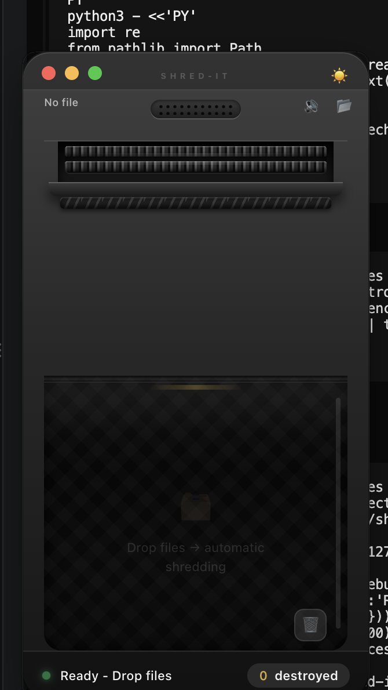

# Shred-it — File Shredder & Secure Delete Tool for macOS and Windows

Shred-it is a floating **paper shredder / secure file deletion** app for the desktop. Drop files into the shredder widget to move them into a private **Shredder Bin**, then **burn the bin** to overwrite and permanently delete them. It is a two-stage secure delete tool with restore, drag & drop, menu-bar/tray access, global shortcuts and animated shredding.

**Keywords:** shredder tool, file shredder tool, desktop shredder tool, secure shredder, file shredder, secure delete, secure file deletion, paper shredder, shred-it, shredder app, data destruction, permanent delete, macOS shredder, Windows file shredder, Electron desktop app, privacy tool, trash cleanup, shred files.

> **Testing status:** v1.0.0 was developed and tested on **macOS only**. The Windows build is cross-compiled from the same source with an NSIS installer, but it has **not been manually tested on Windows** yet. Please report issues.

## Download / install

| Platform | Installer | Notes |
|----------|-----------|-------|
| macOS (Intel + Apple Silicon) | [Shred-it-1.0.0-universal.dmg](https://github.com/ZulfiqarShah9/shred-it/releases/download/v1.0.0/Shred-it-1.0.0-universal.dmg) | Open the DMG and drag **Shred-it.app** to Applications. |
| Windows x64 | [Shred-it.Setup.1.0.0.exe](https://github.com/ZulfiqarShah9/shred-it/releases/download/v1.0.0/Shred-it.Setup.1.0.0.exe) | Run the installer; desktop and Start menu shortcuts are created. |

Verify downloads with `installers/SHA256SUMS.txt` in this repository.

The macOS build is ad-hoc signed, not notarized. On first launch, right-click the app → **Open**, or run:

```bash
xattr -d com.apple.quarantine /Applications/Shred-it.app
```

## How it works

1. **Shred** — drag a file onto the widget, use the 📂 button, or choose *Shred Files…* from the tray/menu-bar icon. The animation plays and the file is moved out of its original folder into the private bin. It can still be restored.
2. **Restore** — use *Restore Files…* in the tray/menu-bar menu to put files back at their original paths.
3. **Burn / Empty bin** — press the 🗑️ button in the widget or *Burn Bin* in the menu. Files in the bin are overwritten (random data twice, zeros once) and permanently deleted. **No confirmation is asked**, so the first launch shows an information screen explaining this.

Built-in settings (gear icon): shred speed, secure-overwrite toggle, auto-empty when full, and bin capacity.

## Shortcuts

| Shortcut | Action |
|----------|--------|
| `Cmd/Ctrl + Shift + S` | Show / hide the widget |
| `Cmd/Ctrl + Shift + X` | Pick files to shred |
| `Cmd/Ctrl + Shift + E` | Burn the bin permanently |

Closing the widget hides it; clicking the macOS Dock icon or the Windows taskbar/shortcut reopens it. On macOS the menu-bar icon is a small white template icon; Windows uses the colored tray icon.

## Bin locations

- macOS: `~/Library/Application Support/shred-it/ShredderBin`
- Windows: `%APPDATA%\shred-it\ShredderBin`

Metadata is stored in `bin.json` next to the `files/` directory inside the bin.

## Screenshot



## Build from source

Requires Node.js 18+ and npm.

```bash
git clone https://github.com/ZulfiqarShah9/shred-it.git
cd shred-it
npm install
npm start                 # run locally
npm run dist              # build macOS dmg + Windows NSIS installer
npm run dist:mac          # macOS only
npm run dist:win          # Windows only
```

Built installers are written to `installers/`. The UI is the standalone `paper-shredder-widget.html`; `main.js` is the Electron main process (tray, window, shortcuts, secure-delete IPC) and `preload.js` is the context-isolated bridge.

## Security note

Overwriting is reliable on traditional hard disks. On modern SSDs (APFS/NTFS, TRIM, copy-on-write) old blocks may survive elsewhere; use FileVault or BitLocker for sensitive data. Only files already inside the Shredder Bin are ever overwritten — files at their original locations are never burned in place.

## Repository layout

```
shred-it/
├── assets/                     # app/tray icons + logo history
├── docs/screenshot.png
├── installers/                 # local copies of v1.0.0 installers + checksums
├── main.js                     # Electron main process
├── preload.js                  # contextBridge API
├── paper-shredder-widget.html  # full widget UI, styles and animations
├── package.json
└── README.md
```

## Version

1.0.0 — see [CHANGELOG.md](CHANGELOG.md).

## License

MIT — see [LICENSE](LICENSE).

## Find this project

- Repository: https://github.com/ZulfiqarShah9/shred-it
- Downloads: https://github.com/ZulfiqarShah9/shred-it/releases/tag/v1.0.0
- Topics: `file-shredder`, `secure-delete`, `shred-it`, `macos`, `windows`, `electron`, `desktop-app`, `privacy`
